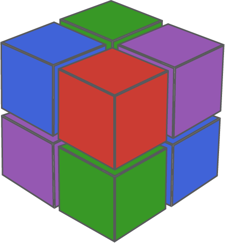

<h1>  ImplicitGlobalGrid.jl </h1>

[](https://eth-cscs.github.io/ImplicitGlobalGrid.jl/stable)
[](https://eth-cscs.github.io/ImplicitGlobalGrid.jl/dev)
[](https://github.com/eth-cscs/ImplicitGlobalGrid.jl/actions/workflows/ci.yml)
[](https://gitlab.com/cscs-ci/ci-testing/webhook-ci/mirrors/1939427232800723/3544630643253668/-/pipelines)
[](https://gitlab.com/cscs-ci/ci-testing/webhook-ci/mirrors/1939427232800723/3544630643253669/-/pipelines)
[](https://gitlab.com/cscs-ci/ci-testing/webhook-ci/mirrors/1939427232800723/3544630643253670/-/pipelines)
[](https://codecov.io/gh/eth-cscs/ImplicitGlobalGrid.jl)

ImplicitGlobalGrid renders the distributed parallelization of stencil-based GPU and CPU applications on a regular staggered grid almost trivial and enables close to ideal weak scaling on thousands of GPUs. The global grid is created *implicitly* from the number of processes: write the code for one GPU/CPU, and **as little as three functions can be enough to turn it into a massively scaling Multi-GPU/CPU application**. Halo updates rely on [MPI.jl](https://github.com/JuliaParallel/MPI.jl) and can leverage CUDA-aware or ROCm-aware MPI; 1-D, 2-D and 3-D grids are supported. Background, contributors and references are in the [documentation](https://eth-cscs.github.io/ImplicitGlobalGrid.jl/stable).

## Documentation
Usage, examples and the API reference are found in the documentation:
- [**stable**](https://eth-cscs.github.io/ImplicitGlobalGrid.jl/stable): documentation of the latest release;
- [**dev**](https://eth-cscs.github.io/ImplicitGlobalGrid.jl/dev): documentation of the `main` branch.

## Installation
```julia
import Pkg; Pkg.add("ImplicitGlobalGrid")
```

## Usage
```julia
using ImplicitGlobalGrid                 # Import CUDA or AMDGPU before ImplicitGlobalGrid to activate GPU support.

nx, ny, nz = 64, 64, 64
me, dims = init_global_grid(nx, ny, nz)  # Create the implicit global grid (and initialize MPI).
A = zeros(nx, ny, nz)
# ... computations on the local grid ...
update_halo!(A)                          # Update the halo of A.
finalize_global_grid()                   # Finalize the implicit global grid (and MPI).
```
Launch the script with the MPI launcher (see the [MPI.jl documentation](https://juliaparallel.org/MPI.jl/stable/usage/)). A complete application is shown in the [50-lines Multi-GPU example](https://eth-cscs.github.io/ImplicitGlobalGrid.jl/stable/examples/diffusion3D_multigpu_CuArrays_novis).

## Questions, comments and discussions
Please post on Julia Discourse in the [GPU topic](https://discourse.julialang.org/c/domain/gpu) or the [Julia at Scale topic](https://discourse.julialang.org/c/domain/parallel), or in the `#gpu` or `#hpc` channels on the [Julia Slack](https://julialang.org/slack/). Contributions are welcome; please open an issue to discuss your idea beforehand.

## Funding
The development of this package is supported by the [GPU4GEO](https://pasc-ch.org/projects/2021-2024/gpu4geo/index.html) and [∂GPU4GEO](https://pasc-ch.org/projects/2025-2028/gpu4geo-differentiable-multi-physics-solvers-for-extreme-scale-geophysics-simulations-on-gpus/index.html) PASC projects. More information about the GPU4GEO project can be found on the [GPU4GEO website](https://GPU4GEO.org/).
