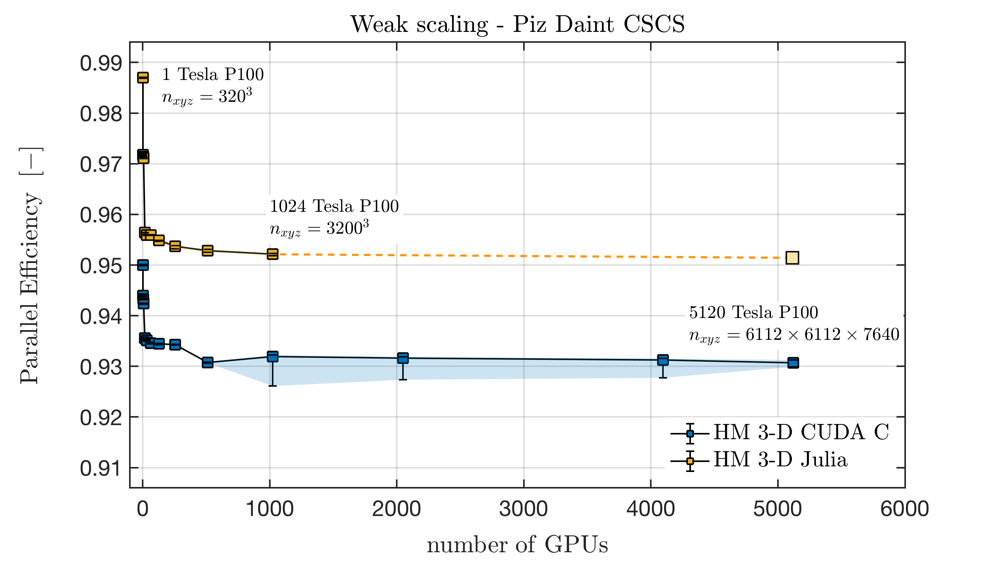
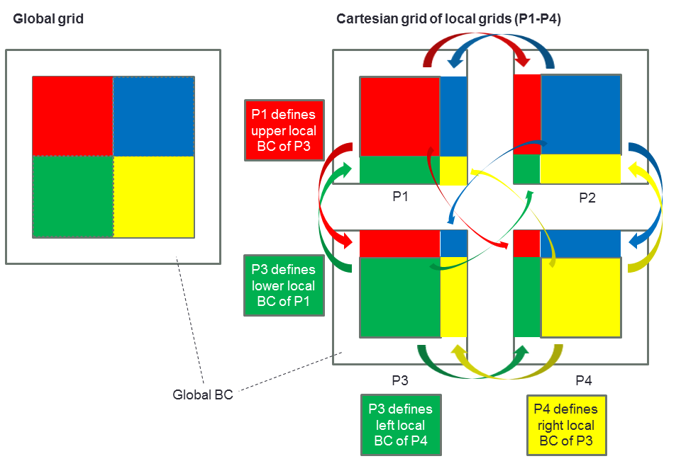

```@raw html
---
layout: home

hero:
  name: ImplicitGlobalGrid.jl
  text: Distributed parallelization of stencil-based GPU and CPU applications
  tagline: Close to ideal weak scaling on thousands of GPUs, with as little as three functions.
  actions:
    - theme: brand
      text: Usage
      link: /usage
    - theme: alt
      text: API reference
      link: /api
    - theme: alt
      text: View on GitHub
      link: https://github.com/eth-cscs/ImplicitGlobalGrid.jl
  image:
    src: /logo.png
    alt: ImplicitGlobalGrid.jl
---
```

## What is ImplicitGlobalGrid.jl?

ImplicitGlobalGrid is an outcome of a collaboration of the Swiss National Supercomputing Centre, ETH Zurich (Dr. Samuel Omlin) with Stanford University and the Geocomputing Centre, University of Lausanne (Dr. Ludovic Räss and Prof. Yuri Podladchikov). It renders the distributed parallelization of stencil-based GPU and CPU applications on a regular staggered grid almost trivial and enables close to ideal weak scaling of real-world applications on thousands of GPUs \[[1](https://pretalx.com/juliacon2019/talk/LGHLC3/), [2](https://pasc19.pasc-conference.org/program/schedule/presentation/?id=msa218&sess=sess144), [3](https://www.youtube.com/watch?v=vPsfZUqI4_0)\]:



ImplicitGlobalGrid relies on the Julia MPI wrapper ([MPI.jl](https://github.com/JuliaParallel/MPI.jl)) to perform halo updates close to hardware limit and leverages CUDA-aware or ROCm-aware MPI for GPU-applications. The communication can straightforwardly be hidden behind computation \[[1](https://pretalx.com/juliacon2019/talk/LGHLC3/), [3](https://www.youtube.com/watch?v=vPsfZUqI4_0)\] (how this can be done automatically when using ParallelStencil.jl is shown in \[[3](https://www.youtube.com/watch?v=vPsfZUqI4_0)\]; a general approach particularly suited for CUDA C applications is explained in \[[4](https://on-demand.gputechconf.com/gtc/2019/video/_/S9368/)\]).

A particularity of ImplicitGlobalGrid is the automatic *implicit creation of the global computational grid* based on the number of processes the application is run with (and based on the process topology, which can be explicitly chosen by the user or automatically defined). As a consequence, the user only needs to write a code to solve his problem on one GPU/CPU (*local grid*); then, **as little as three functions can be enough to transform a single GPU/CPU application into a massively scaling Multi-GPU/CPU application**. See the [50-lines Multi-GPU example](@ref example-50-lines). 1-D, 2-D and 3-D grids are supported. Here is a sketch of the global grid that results from running a 2-D solver with 4 processes (P1-P4) (a 2x2 process topology is created by default in this case):



## Installation
ImplicitGlobalGrid can be installed directly with the [Julia package manager](https://docs.julialang.org/en/v1/stdlib/Pkg/) from the [Julia REPL](https://docs.julialang.org/en/v1/stdlib/REPL/):
```julia-repl
julia>]
  pkg> add ImplicitGlobalGrid
```

## Dependencies
ImplicitGlobalGrid relies on the Julia MPI wrapper ([MPI.jl](https://github.com/JuliaParallel/MPI.jl)) and [CellArrays.jl](https://github.com/omlins/CellArrays.jl); GPU support is provided through package extensions for the Julia CUDA package ([CUDA.jl](https://github.com/JuliaGPU/CUDA.jl) \[[5](https://doi.org/10.1109/TPDS.2018.2872064), [6](https://doi.org/10.1016/j.advengsoft.2019.02.002)\]) and the Julia AMDGPU package ([AMDGPU.jl](https://github.com/JuliaGPU/AMDGPU.jl)), and multi-threaded CPU halo copies through [Polyester.jl](https://github.com/JuliaSIMD/Polyester.jl).

## Contributors
The principal contributors to [ImplicitGlobalGrid.jl](https://github.com/eth-cscs/ImplicitGlobalGrid.jl) are (ordered by the significance of the relative contributions):
- Dr. Samuel Omlin ([@omlins](https://github.com/omlins)), CSCS - Swiss National Supercomputing Centre, ETH Zurich
- Dr. Ludovic Räss ([@luraess](https://github.com/luraess)), Geocomputing Centre, University of Lausanne
- Dr. Ivan Utkin ([@utkinis](https://github.com/utkinis)), Laboratory of Hydraulics, Hydrology, Glaciology - ETH Zurich

## Questions, comments and discussions
To discuss technical issues, please post on Julia Discourse in the [GPU topic](https://discourse.julialang.org/c/domain/gpu) or the [Julia at Scale topic](https://discourse.julialang.org/c/domain/parallel) or in the `#gpu` or `#hpc` channels on the [Julia Slack](https://julialang.org/slack/).
To discuss numerical/domain-science issues, please post on Julia Discourse in the [Numerics topic](https://discourse.julialang.org/c/domain/numerics) or the [Modelling & Simulations topic](https://discourse.julialang.org/c/domain/models) or whichever other topic fits best your issue.

## Your contributions
This project welcomes your contribution! Have you developed an application with ImplicitGlobalGrid that could be featured as an example? Please contribute it to share it with the world (if your application uses also ParallelStencil then contribute it as a mini-app in the corresponding repository)! Are you missing a convenience feature (like [`gather!`](@ref))? Then write it using MPI and contribute it to ImplicitGlobalGrid! Are you missing a great feature in the core of ImplicitGlobalGrid? Maybe you can contribute yourself!
Please open an issue to discuss your idea for a contribution beforehand. Furthermore, note that a pull request should always address an issue in its completeness. Moreover, pull requests should blend nicely into the existing project; common sense is the primary guide in this regard (community guideline documents, e.g. [ColPrac](https://github.com/SciML/ColPrac), can be consulted in addition for inspiration). We are looking forward to your contribution!

## References
\[1\] [Räss, L., Omlin, S., & Podladchikov, Y. Y. (2019). Porting a Massively Parallel Multi-GPU Application to Julia: a 3-D Nonlinear Multi-Physics Flow Solver. JuliaCon Conference, Baltimore, USA.](https://pretalx.com/juliacon2019/talk/LGHLC3/)

\[2\] [Räss, L., Omlin, S., & Podladchikov, Y. Y. (2019). A Nonlinear Multi-Physics 3-D Solver: From CUDA C + MPI to Julia. PASC19 Conference, Zurich, Switzerland.](https://pasc19.pasc-conference.org/program/schedule/presentation/?id=msa218&sess=sess144)

\[3\] [Omlin, S., Räss, L., Kwasniewski, G., Malvoisin, B., & Podladchikov, Y. Y. (2020). Solving Nonlinear Multi-Physics on GPU Supercomputers with Julia. JuliaCon Conference, virtual.](https://www.youtube.com/watch?v=vPsfZUqI4_0)

\[4\] [Räss, L., Omlin, S., & Podladchikov, Y. Y. (2019). Resolving Spontaneous Nonlinear Multi-Physics Flow Localisation in 3-D: Tackling Hardware Limit. GPU Technology Conference 2019, San Jose, Silicon Valley, CA, USA.](https://on-demand.gputechconf.com/gtc/2019/video/_/S9368/)

\[5\] [Besard, T., Foket, C., & De Sutter, B. (2018). Effective Extensible Programming: Unleashing Julia on GPUs. IEEE Transactions on Parallel and Distributed Systems, 30(4), 827-841. doi: 10.1109/TPDS.2018.2872064](https://doi.org/10.1109/TPDS.2018.2872064)

\[6\] [Besard, T., Churavy, V., Edelman, A., & De Sutter B. (2019). Rapid software prototyping for heterogeneous and distributed platforms. Advances in Engineering Software, 132, 29-46. doi: 10.1016/j.advengsoft.2019.02.002](https://doi.org/10.1016/j.advengsoft.2019.02.002)
